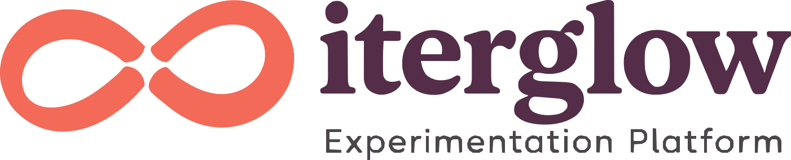

Status: active
Last-Validated: 2026-11-04

# Iterglow CI 사용 가이드

2026년 11월 4일 사용자가 선택한 Iterglow 로고의 색상·배치·아이콘 사용 기준입니다. 서비스와 팀 페이지에서 같은 제품 자산을 사용합니다. 전체 배포 파일은 [브랜드 자산 폴더](../assets/iterglow/)에 있습니다.

## 이름과 의미

- 제품명: **Iterglow · 이터글로**. 로고 도형의 글자는 소문자 `iterglow`입니다.
- 로고 내 설명어: **Experimentation Platform / 실험 플랫폼**.
- 제품 소개용 설명: **오픈소스 A/B 테스트·실험 플랫폼**. 로고 내 설명어가 이 소개 문구를 대체하지 않습니다.
- 팀 이름: **Data Initiative / 데이터 이니셔티브**. 커뮤니티 이름: **Pseudo Lab / 가짜연구소**.

두 고리는 비교할 서로 다른 대안, 가운데 밝은 여백은 관찰을 통해 얻는 판단의 근거, 돌아오는 곡선은 다음 실험으로 이어지는 학습을 표현합니다. 팀 이름을 제품명으로 바꾸거나, 로고의 빛을 항상 이기는 결과·자동 최적화의 보장으로 설명하지 않습니다.

## 로고 파일

| 용도 | SVG | 투명 PNG |
|---|---|---|
| 밝은 배경의 기본 로고 | [기본 로고](../assets/iterglow/iterglow-logo.svg) | [1600px](../assets/iterglow/iterglow-logo.png) |
| 어두운 배경의 기본 로고 | [다크 로고](../assets/iterglow/iterglow-logo-dark.svg) | [1600px](../assets/iterglow/iterglow-logo-dark.png) |
| 소개 영역의 설명 포함 로고 | [설명 포함](../assets/iterglow/iterglow-logo-tagline.svg) | [1600px](../assets/iterglow/iterglow-logo-tagline.png) |
| 어두운 소개 영역 | [설명 포함 다크](../assets/iterglow/iterglow-logo-tagline-dark.svg) | [1600px](../assets/iterglow/iterglow-logo-tagline-dark.png) |
| 작은 공간의 심볼 | [코랄 심볼](../assets/iterglow/iterglow-symbol.svg) | [512px](../assets/iterglow/iterglow-symbol.png) |
| 어두운 배경의 흰 심볼 | [흰 심볼](../assets/iterglow/iterglow-symbol-white.svg) | [512px](../assets/iterglow/iterglow-symbol-white.png) |

단색 용도: [검정 로고](../assets/iterglow/iterglow-logo-mono.svg), [흰 로고](../assets/iterglow/iterglow-logo-white.svg), [검정 심볼](../assets/iterglow/iterglow-symbol-mono.svg). 설명이 필요하면 [검정 설명 포함](../assets/iterglow/iterglow-logo-tagline-mono.svg) 또는 [흰 설명 포함](../assets/iterglow/iterglow-logo-tagline-white.svg)을 사용합니다. [워드마크 단독 SVG](../assets/iterglow/iterglow-wordmark.svg)도 제공합니다.

SVG는 폰트·외부 이미지에 의존하지 않는 path 자산입니다. [승인 원본](../assets/iterglow/source/approved.png)의 글자 윤곽을 복원했으며, 전용 폰트 파일을 제공하는 것은 아닙니다. 워드마크를 다른 글꼴의 라이브 텍스트로 대체하지 않습니다. 앱 본문 폰트는 기존 [디자인 시스템](design_system.md)을 따릅니다.

## 색상

| 이름 | HEX | 용도 |
|---|---|---|
| Coral | `#F36A58` | 제품 심볼·장식 강조 |
| Plum | `#542D48` | 밝은 배경의 워드마크·문구·주요 동작 |
| Paper | `#FFF9F3` | 밝은 바탕·다크 로고의 글자 |
| Ink | `#28262A` | 기본 문구·단색 자산 |

[CSS 브랜드 토큰](../assets/iterglow/tokens.css)을 제공합니다. 앱 전체 테마 변수에 일괄 대입하지 않습니다.

Coral과 흰색의 대비는 약 **2.99:1**이므로 작은 문구나 흰 글씨 버튼 배경에는 그대로 사용하지 않습니다. 이런 용도에는 Plum을 사용합니다. Plum과 Paper의 대비는 약 **10.89:1**입니다.

## 크기와 여백

- 비율을 유지하고 주변에 로고 높이의 **½ 이상** 여백을 확보합니다.
- 설명 없는 전체 로고는 폭 **160px 이상**을 권장합니다.
- 설명 포함 로고는 폭 **320px 이상**에서 사용합니다. 헤더·사이드바에는 설명 없는 로고를 사용합니다.
- 더 좁은 공간에는 심볼을 사용합니다. 다크 배경에서는 다크·흰색 버전을 선택합니다.
- 회전·기울임·임의 재색칠·그림자 추가는 피합니다. 특히 단어의 일부만 다른 글꼴이나 기울임으로 바꾸지 않습니다.

## 파비콘과 홈 화면 아이콘

| 용도 | 파일 |
|---|---|
| 벡터 파비콘 | [favicon.svg](../assets/iterglow/favicon.svg) |
| 16·32·48px를 포함한 ICO | [favicon.ico](../assets/iterglow/favicon.ico) |
| 개별 PNG 파비콘 | [16px](../assets/iterglow/icon-16.png) · [32px](../assets/iterglow/icon-32.png) · [48px](../assets/iterglow/icon-48.png) · [64px](../assets/iterglow/icon-64.png) |
| Apple 홈 화면 | [180px](../assets/iterglow/apple-touch-icon.png) |
| 큰 앱 아이콘 | [192px](../assets/iterglow/icon-192.png) · [512px](../assets/iterglow/icon-512.png) |

코랄 바탕과 흰 심볼을 사용합니다. 16px에서는 중앙의 빛 여백이 작아 일반적인 두 고리로 읽힐 수 있습니다. 작은 크기에서는 설명 문구나 워드마크를 추가하지 않습니다.

## 자산 관리와 적용

이 가이드와 `docs/assets/iterglow/`가 전체 CI 자산의 기준입니다. 로고를 갱신할 때 가이드와 자산을 함께 검토하고, 실제 적용에 사용하는 파일도 같은 내용으로 맞춥니다.

- 서비스 적용 파일: [`frontend/public/brand/`](../../frontend/public/brand/).
- 팀 페이지: 이 저장소의 독립 `pages` 브랜치. 제품 자산은 같은 키트를 사용하고 팀의 Data Initiative 이름은 유지합니다. 앱 main 이력을 pages에 병합하지 않습니다.
- [자산별 SHA256·색상·버전 명세](../assets/iterglow/manifest.json)와 [윤곽·대비 검증 기록](../assets/iterglow/validation.json)을 함께 보관합니다.
- [제작 메타데이터](../assets/iterglow/source/trace-metadata.json)에 원본 윤곽의 복원 방식을 기록합니다.
- 로고 적용은 API 경로·npm 패키지명·도메인·인증 설정의 변경을 요구하지 않습니다.

서비스 적용 및 운영 확인 기록은 [2026년 11월 4일 브랜드 자산 핸드오프](../reports/handoffs/2026-11-04-iterglow-brand-assets.md)에 있습니다.
